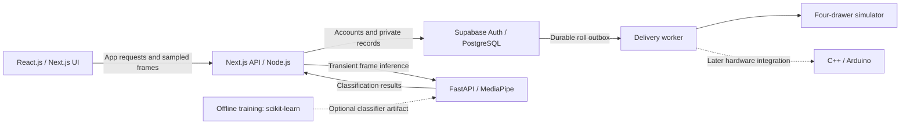

<div align="center">

# SLOTTY

### Build habits. Earn tokens. Spin for rewards.

A task-powered reward system connected to a four-compartment locker.

[Features](#page-by-page-features) · [Deliverables](#project-deliverables) · [Workflows](#user-workflows) · [Documentation](#project-documentation)

</div>

---

## About the project

TTBuildProject turns everyday effort into a chance to reclaim your favorite items. Place items in four locked compartments, complete activities to earn tokens, then allocate those tokens to the drawers you want to open.

Each roll has two stages: **do you win something?** If you do, **which drawer opens?** Spending more tokens improves your overall chance of winning, while your allocation influences which item you receive. A roll can unlock at most one drawer.

> **Project status:** The basic Next.js application shell has five main pages, a shared sidebar, and Studbot/run-tracker routes. The tables below describe planned features; activity tracking, accounts, rewards, backend services, firmware, and the locker are still pending. Current delivery focuses on auth, activities, goals/history and earning tokens in `tokenBalance`. Redemption, spending, locker/drawer tables and unlock delivery are deferred until the hardware is ready.

## Run the starter app

Use Node.js 22.20+ and npm 10.9.3+. If you use nvm, run `nvm use` first.

```sh
npm ci
npm run dev
```

Open [localhost:3000](http://localhost:3000). The root redirects to `/dashboard`. This starter needs no environment variables or backend services.

On phones, the three-bar menu button opens and closes navigation. Selecting a page closes the menu; Escape closes it and returns focus to the button. Desktop navigation stays in the left sidebar.

Run `npm run check` for lint, TypeScript checking, and a production build. `npm run start` serves the production build. See [Contributing](CONTRIBUTING.md) for the page file map and how to start a teammate branch.

## Page-by-page features

| Page | Purpose | Features |
| --- | --- | --- |
| **Dashboard** | See what you want to accomplish today. | Activity-specific daily goals; individual time progress such as **Study: 35/60 minutes**; completed tasks; token balance; tokens earned today; a shortcut to redeem rewards. |
| **Tasks** | Start activities and earn tokens. | Studbot, run/walk tracking, and custom tasks; built-in session controls; required custom minimum-duration targets of at least 30 minutes; one optional reflection question per custom task. |
| **History** | Review your completed activities. | Task name, description/reflection, date and time, duration, and tokens earned; newest-first daily groups; this-week, this-month, and all-time filters; saved run/walk summaries. |
| **Redeem** | Spend tokens for a chance to open a drawer. | Four named items and drawer states; per-drawer token allocation; total cost and probability preview; two-stage rolls; win/loss results; unlock status and retry after a delivery failure. |
| **Profile** | Keep your activity and rewards personal. | Account access; editable display name and timezone; private goals, task history, token balance, and associated locker. |

### Activity modes

| Mode | How it works |
| --- | --- |
| **Studbot** | Uses calibrated presence and orientation toward your screen or study materials. Reading and writing while looking down count. Sustained absence or looking away pauses the session after about five seconds; two valid seconds resume it automatically while preserving counted time. Sampled camera frames are analyzed live and discarded without saving footage. |
| **Run / Walk** | Shows a map, route, distance, and timer with manual start, pause/resume, and stop controls. Standing still does not automatically pause the timer. Missing GPS coverage does not invent distance. |
| **Custom tasks** | Create activities such as crochet, reading, or practice. Use a built-in timer, require a minimum duration of at least 30 minutes (exactly 30 is valid), and optionally ask a completion question such as **“What did you make?”** Rewards use measured time, not manually entered duration. |


## Project deliverables

The delivery scope includes the following:

| Deliverable | Included scope |
| --- | --- |
| **Five-page application** | Dashboard, Tasks, History, Redeem, and Profile with responsive layouts, consistent navigation, accessible controls and clear loading, empty, and error states. |
| **Studbot activity verification** | Camera setup/calibration, study-compatible presence/orientation classification, automatic pause/resume, and transient frame processing. |
| **Run/walk tracker** | Map and route display, distance measurement, manual timer controls, and saved activity summaries. |
| **Custom-task system** | Task creation, measured timers, mandatory minimum targets of at least 30 minutes, and optional completion reflections. |
| **Daily goals and schedules** | Per-activity time targets, today/daily/weekday recurrence, and independent progress for each date. |
| **Accounts and activity records** | Profiles, private completion history, token balances, and earning/spending records. |
| **Token and roll engine** | Time-based rewards, per-drawer allocations, probability previews, two-stage random outcomes, and protection against duplicate rewards or charges. |
| **Four-drawer simulator** | Item assignment, locked/open states, collection and reload, offline behavior, and unlock-acknowledgement failure testing. |
| **Physical locker and firmware** | Four lockable compartments, item-to-drawer mapping, roll-result communication, and control of the matching lock after a win; gates the later redemption/database integration milestone. |
| **Integration and validation** | End-to-end activity-to-unlock flow, reliable retry behavior, account isolation, privacy checks, usability checks, and documented validation results. |
| **Project documentation** | Constitution, feature specification, technical plan, data model, interface contracts, validation guide, and implementation checklist. |

## User workflows

### 1. Prepare your rewards

Assign an item to each of the four drawers and lock it. The Redeem page shows which items are available. This workflow is deferred until hardware readiness; the current milestone focuses on earning tokens.

### 2. Plan your day

Create goals such as **Study for 60 minutes**, **Walk for 30 minutes**, or **Crochet for 45 minutes**. Choose when each goal repeats, then follow its progress on the Dashboard.

### 3. Complete an activity

Start Studbot, a run/walk, or a custom-task timer. Pause and resume as needed, then finish the activity and answer its reflection question if one is configured. The completion appears in History and eligible time earns tokens.

**Every custom task requires a minimum duration of 30 minutes or more.** You cannot mark it complete or earn its tokens before reaching its selected minimum. Exactly 30 minutes is allowed; a task set to 45 minutes must reach 45 minutes.

**One token is earned for every full 30 minutes within a completed session.** Leftover minutes are discarded per session.

| Completed session | Tokens earned |
| --- | ---: |
| 30 minutes | 1 |
| 45 minutes | 1 |
| 60 minutes | 2 |

Daily-goal progress can combine sessions: two 20-minute study sessions contribute **40 minutes** toward a daily study goal, while earning **0 tokens** because neither session reaches 30 minutes.

### 4. Allocate tokens and roll

1. Open Redeem and select the drawers you want to play for.
2. Allocate whole tokens to those drawers and review the total cost and chances.
3. Roll: the total allocation determines whether you win anything.
4. If you win, the allocation weights determine which one funded drawer opens.
5. Collect the item, then reload and relock the drawer when it is ready for another reward.

Allocated tokens are spent on both wins and losses. The starting win chance is **20% with one token**, increasing toward **60%** as more tokens are spent; the current curve gives approximately **58% at ten tokens**. If an unlock acknowledgement fails, retry delivery of the same winning result without paying or rolling again.

### 5. Review your progress

Check the Dashboard for today's goals and earnings, or filter History to review past activities and reflections. Your profile keeps this activity and locker access tied to your account.

## Tech stack

The stack below covers the web app, activity tracking, ML service, and locker firmware. React, Next.js, TypeScript, and the basic CSS layout are installed in the starter; backend, tracking, ML, and hardware integrations remain planned. Training and continuous-streaming additions are identified below.

### Application, services, and hardware

| Layer | Technologies | Role in SLOTTY |
| --- | --- | --- |
| **Frontend** | React.js, Next.js App Router, TypeScript, CSS modules / CSS variables | Responsive pages, navigation, timers, daily goals, history, and redeem controls. |
| **Application backend** | Node.js, Next.js API routes, schema validation | Authenticated activity endpoints, session controls, token accounting, and roll requests. |
| **Authentication and database** | Supabase Auth, PostgreSQL, Row Level Security, `@supabase/ssr` | User accounts, private profiles and routes, goal schedules, completion history, `tokenBalance`, and later roll records. |
| **Transactions and locker delivery** | PostgreSQL RPC functions, Node.js `crypto`, persistent outbox worker | Atomic credits/spending, secure roll decisions, fixed outcomes, and retryable drawer commands. |
| **Camera capture** | [MediaDevices `getUserMedia`](https://developer.mozilla.org/en-US/docs/Web/API/MediaDevices/getUserMedia), MediaStream, HTML Canvas | Request camera permission, preview the feed, and create small sampled JPEG frames. |
| **Camera-to-model transport** | Authenticated HTTPS requests through Next.js to FastAPI | Send sampled frames for transient inference; return classification results without saving footage. |
| **ML API and runtime** | Python 3.11, FastAPI, Uvicorn, Pydantic | Private inference endpoints, request validation, model loading, and bounded processing. |
| **Vision models** | [MediaPipe Face Landmarker](https://developers.google.com/edge/mediapipe/solutions/vision/face_landmarker/python) and [Pose Landmarker](https://developers.google.com/edge/mediapipe/solutions/vision/pose_landmarker) | Extract face/body landmarks for presence and calibrated head-orientation classification. |
| **Image and feature processing** | NumPy, Pillow; OpenCV where needed for pose geometry | Decode and resize bounded frames, calculate orientation features, and handle numeric model inputs. |
| **Location and maps** | Browser Geolocation API, MapLibre GL JS, OpenFreeMap | Run/walk location, route segments, map display, and distance measurement. |
| **Locker firmware** | C++, Arduino | Control the four physical locks and handle unlock acknowledgements when hardware is integrated. |
| **Local development** | Node.js, npm, Python, uv, Supabase CLI, Docker, Git / GitHub | Reproducible dependencies, local services, migrations, source control, and model versioning. |
| **Testing and validation** | Vitest, Playwright, pytest, FastAPI TestClient, SQL / RLS tests | Check the UI, timers, model contracts, privacy, account isolation, token transactions, and hardware-simulator recovery. |

### ML pipeline and training

The first prototype uses pretrained MediaPipe models plus calibrated orientation rules. A learned classifier can be trained later on labeled landmark features; no custom classifier has been trained yet.

| Stage | Tools / approach | Output |
| --- | --- | --- |
| **Feature preparation** | Python, NumPy, pandas | Clean labeled examples of screen-facing study, book reading/writing, away, and unverifiable views; normalize features against calibration. |
| **Classifier training — extension** | [scikit-learn](https://scikit-learn.org/stable/modules/ensemble.html#forest), with a Random Forest as a starting candidate | A learned classifier over landmark/orientation features, evaluated against the calibrated-rule baseline. |
| **Evaluation** | [GroupKFold](https://scikit-learn.org/stable/modules/generated/sklearn.model_selection.GroupKFold.html), precision / recall / F1, confusion matrices; Matplotlib for reports | Separate training and validation groups by person/session and measure errors on reading, writing, away, and unknown cases. |
| **Model packaging — extension** | joblib, versioned model metadata and checksums | A reproducible classifier artifact loaded by FastAPI alongside its feature and calibration versions. |

Offline training uses a separately prepared, consented or appropriately licensed dataset. Live Studbot frames are analyzed and discarded; recording user study footage is not part of this pipeline. Landmark and posture predictions describe observable behavior, not proof of learning or cognitive attention.

### WebRTC and streaming

The initial camera path uses browser capture plus sampled HTTPS uploads, so it does not require a continuous WebRTC connection. If continuous low-latency video becomes necessary, the streaming extension would use the browser's [WebRTC API](https://developer.mozilla.org/en-US/docs/Web/API/WebRTC_API) and Python [aiortc](https://aiortc.readthedocs.io/en/latest/), with signaling and STUN/TURN connectivity configured for deployment.

### System overview



## Project documentation

Detailed planning documents are included in this branch. The implementation checklist records completed work separately from the remaining feature backlog.

| Document | What you will find |
| --- | --- |
| [Project constitution](.specify/memory/constitution.md) | Guiding principles, product boundaries, and verification rules. |
| [Feature specification](specs/001-task-reward-locker/spec.md) | All features, user decisions, scenarios, and acceptance criteria. |
| [Technical plan](specs/001-task-reward-locker/plan.md) | Architecture and delivery sequence. |
| [Data model](specs/001-task-reward-locker/data-model.md) | Records, relationships, and lifecycle rules. |
| [Interface contracts](specs/001-task-reward-locker/contracts) | Application, ML-service, and locker interfaces. |
| [Implementation checklist](specs/001-task-reward-locker/tasks.md) | 72 ordered tasks with completion and partial-scope notes. |
| [Validation guide](specs/001-task-reward-locker/quickstart.md) | Runnable starter setup and future full-system acceptance checks. |
